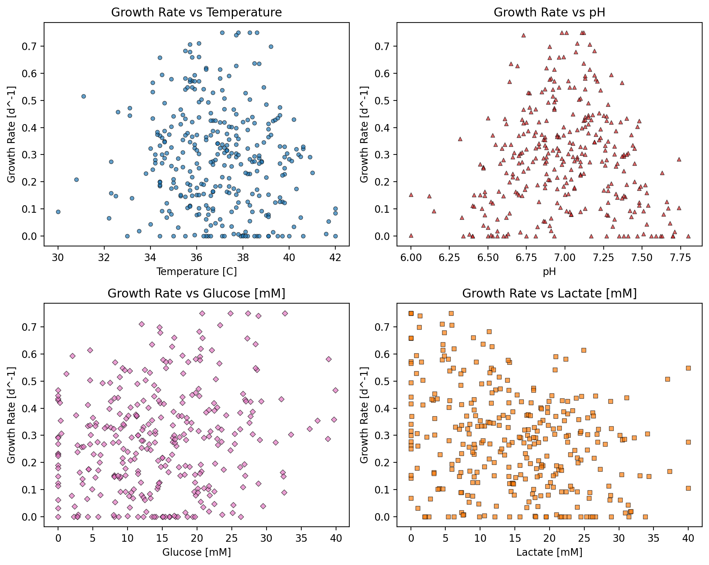
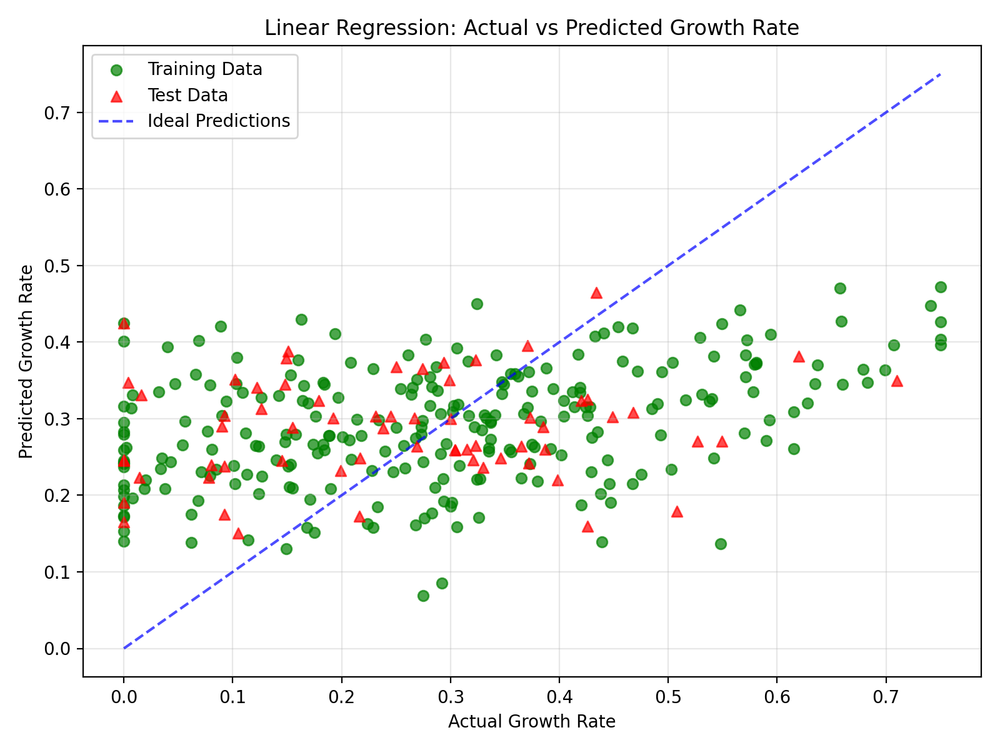
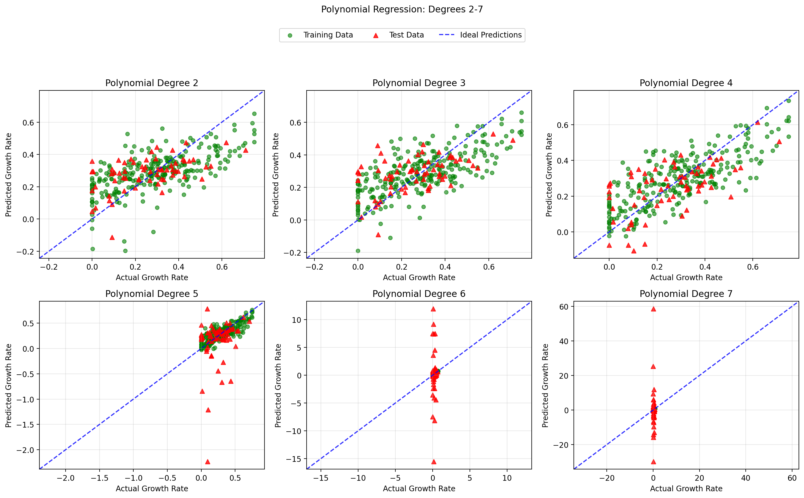
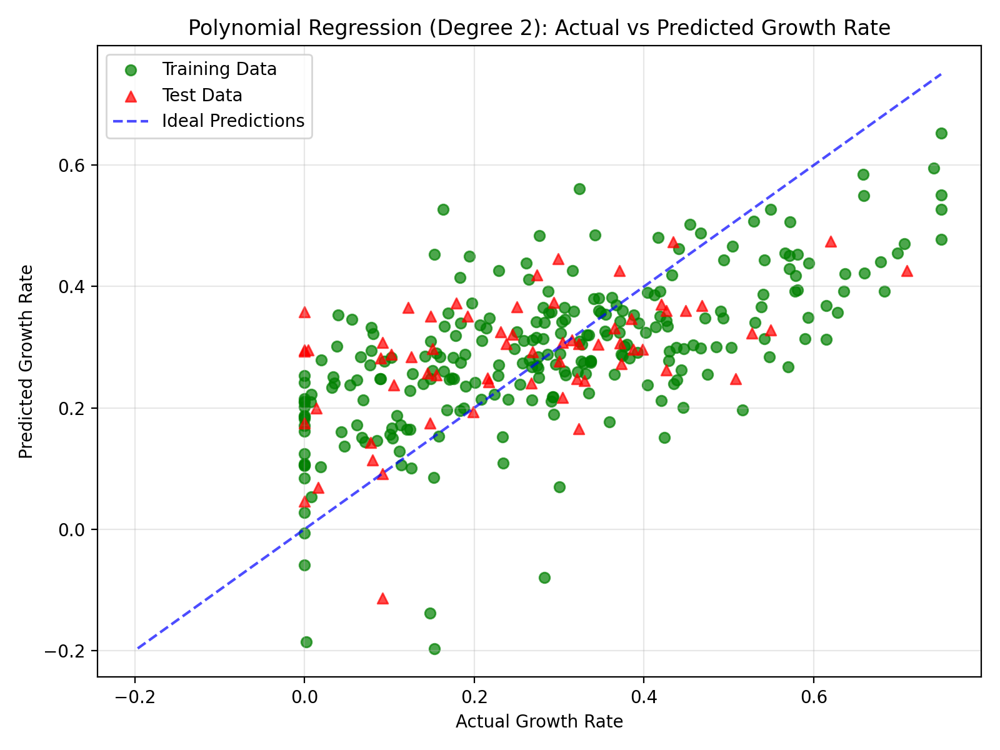
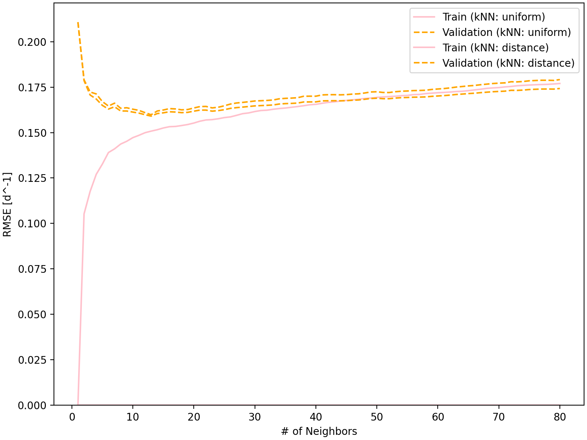
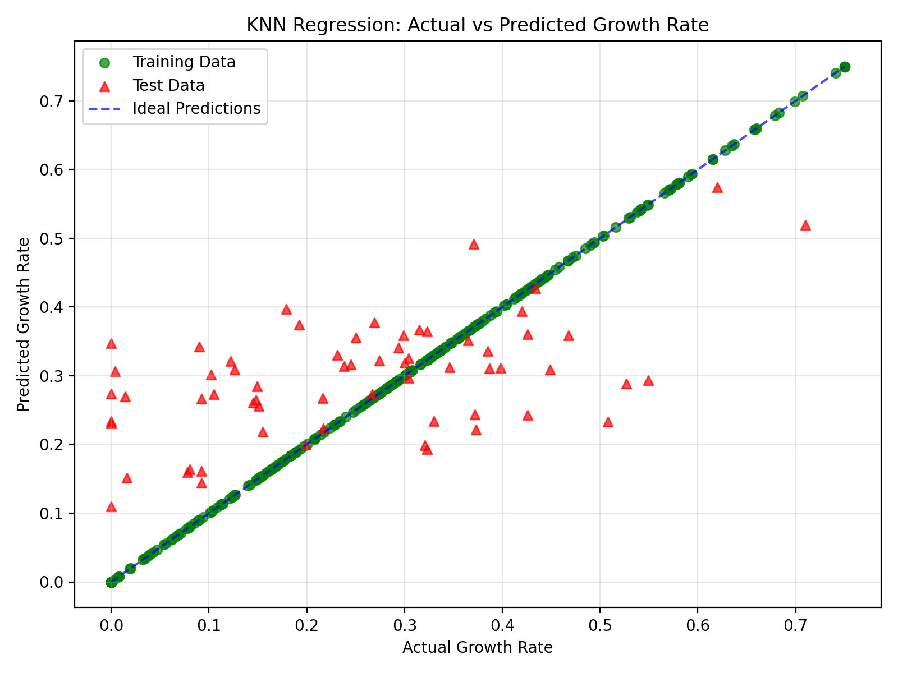

# Monitoring and Assessing Cell Growth Rates in Bioreactors Using Machine Learning
## About
#### Predicts the rate of cell growth for a variety of changing bioreactor conditions, while comparing the predictive performance of different regression models. 

This program uses temperature, pH, glucose and lactate levels to estimate the specific growth rate of cells in a bioreactor by comparing linear, polynomial and k-nearest neighbours (KNN) regressions. It also helps estimate the speed at which the cells grow in the bioreactor when changing certain process variables, without the need to measure the growth rates at each possible combination of conditions.

### Highlights
- Analyzed raw bioreactor data using Pandas 
- Implemented linear, polynomial and KNN regression models 
- Generated plots using regression data and comparing the model predictions 
- Evaluated the optimal regression model using RMSE and R^2 
- Optimized KNN regression using cross-validation

### Environment
- Python 3.9.6
- Matplotlib 3.9.4 
- pandas 2.3.3 
- scikit-learn 1.6.1
- NumPy 2.0.2

## Code Design 
Regression models learn the relationship between the input variables, in this case, temperature, pH, glucose, and lactate concentrations. Those variables are used to predict the specific growth rate of the cells, instead of having to measure the growth rate at every potential combination of parameters. The three regression models used differ in how they evaluate the relationships between the inputs and the specific growth rate. 

### Linear Regression
Linear regressions are a good method to represent the relationships between the independent and dependent variables. This method of prediction assumes the relationship can be approximated by a straight-line combination of the inputs. Before fitting the model, the inputs are standardized. Due to the fact that the input data uses different units and numerical ranges, for example, glucose and lactate concentrations are measured in millimoles, while temperature is measured in degrees Celsius. The StandardScaler() function transforms these variables to a comparable scale using values learned from the training data. These same scaling values prevent information from the test dataset influencing preprocessing. 

The model learns using the supplied training data, analyzing coefficients that correspond to the way the input variables relate to the growth rate. The goal of fitting the model to the training data is to minimize prediction errors when comparing to the training data. The code makes growth rate predictions for both the training and testing datasets. These predictions measure the performance of the model to evaluate data it had already seen, while the testing predictions show how well it performs on data that it has not seen. This is a vital step to ensure the model works properly, though they do not guarantee how the model will perform in real-life situations. 

### Polynomial Regression 
Similar to linear regression, polynomial regression predicts specific growth rates using the input parameter data. However, while linear regression uses straight-line relationships between the independent variables and the growth rate, polynomial regression can encapsulate more complex, curved relationships. In this code sequence, a pipeline is made to connect the standardization, polynomial generation, and linear regression into a single sequence. The PolynomialFeatures() generates features up until the specified polynomial degree before the model is fitted. Five-fold cross validation is used to test how well it performs across multiple splits of training data. The training data is split into 5 parts, and the model is trained on four of those parts while it validates the remaining part. This sequence repeats until each part of the data has been used for validation once. It then calculates the mean and standard deviation across all five runs of both the root mean squared error and R^2. Multiple different degrees are tested to see which one fits the data the best. Each degree is tested and then exported to a comparison table where the RMSE and R^2 values can be compared to select the best-fitting model. The chosen polynomial degree can be specified in the code, and it uses that model to generate predictions for the training and testing datasets. A figure for each of the varying degrees is generated, calling a class to the main code. 

### k-Nearest Neighbours Regression
This regression model is fitted using the training data and selects the best setting through cross-validation, which makes it different from the other models. It predicts the growth rates for the training and testing datasets using that selected model. Unlike linear and polynomial regression, it predicts the growth rate based on the observed growth rates of its neighbours, as opposed to fitting global equations. Standardization is necessary, as KNN relies on the distances between data points, and variables with larger numerical ranges could dominate the distance calculations. Standardizing the data helps each input variable contribute more evenly to the distance calculation. 

The code tests different numbers of neighbours, ranging from 1 to 80, and compares two different weighting methods. The uniform weighting method displays how all selected neighbours contribute equally to the predictions, whereas the distance weighting method gives closer neighbours with greater influence. The GridSearchCV() function tests all of the potential combinations using a 4-fold cross-validation. The training data is divided into four parts, with three used to train the model and the remaining one used for validation. This repeats until each part has been used for validation once. The combination with the lowest average validation root mean squared error was selected. The code also generates a validation curve that plots the training and validation RMSE values against the number of neighbours for both evaluation methods. This allows the model performance to be compared across various settings and help determine if the model may be overfitting. The selected model is then used to predict the training and test data growth rates. The RMSE is calculated to measure prediction error, and R^2 is calculated to assess how well the growth rate predictions explain variation.    

RMSE and R^2 are used to evaluate each model, and the results are tabulated for comparison. Lower RMSE and higher R^2 values typically indicate a better predictive performance. The plotting of all the regression methods is organized on the classes file and called from the main file. These plots visually compare the predicted growth rates with observed values for the testing and training datasets. 

## Analysis

### Effects of Process Variables
The temperature, pH, glucose and lactate concentrations may influence the specific cell growth through different biological processes. Considering all the independent variables together is important because a combinations of the conditions may result in different growth rates, compared to when individual variables are considered. For example, cell growth may increase with the pH level to an optimum point and then decrease. Temperature has a similar response, while excess lactate and glucose can be associated with reduced growth.

**Figure 1.** Interactions Between Individual Variables and Growth Rate

As shown in Figure 1, it can be observed that higher growth rates appeared when the temperature is between 35 and 38°C and the pH values near 6.8 to 7.2. The concentration of glucose appears to have a weak positive relationship with growth rate, with some of the highest growth rates occurring at moderate to high glucose concentrations. As opposed to lactate, which appears to show a weak negative relationship with growth rate, as higher lactate concentrations are more frequently associated with lower growth rates. Nonetheless, enough variability is present in all of the plots, which suggests the specific growth rate is impacted by interactions between process variables. 

Three different regression models were evaluated in order to determine which model best represents the cell growth data and predicts the specific growth rates. The models were trained using different evaluation methods, namely cross-validation and an 80/20 train-test split. Each model’s performance was compared using the root mean squared error (RMSE) and coefficient of determination (R^2). Cross-validation assessed the performance across different training and validation splits, while plots were used to compare model predictions with the actual growth rates and ideal predictions.

### Linear and Polynomial Regression 
The linear regression model provides a preliminary baseline against which more complex regression models can be evaluated. Instead of examining each variable separately, the model uses temperature, pH, glucose concentration, and lactate concentration together to predict cell growth rate. This allows the model to estimate a coefficient for each input and represents its linear association with the anticipated growth rate, while holding the other parameters constant. One limitation to this model is that it assumes the relationship between each input feature and specific growth rate can be represented by a linear combination of features. Biological systems, however, can have nonlinear responses to changes in their process variables. Interactions between variables may also influence growth but are not explicitly represented in the basic linear model.

**Table 1.** Linear Regression Comparison: RMSE and R^2

|Model                |Train RMSE        |Train R^2        |Test RMSE          |Test R^2           |
|---------------------|------------------|-----------------|-------------------|-------------------|
|Linear Regression    |0.17682755356460167|0.15907644663029452|0.17196785534094106|-0.08769403737296866|

The test R^2 is negative (-0.0877), suggesting that the model performed worse on the test set than a reference model that predicts the mean of the actual growth rate in the test set. Since the training R^2 is low (0.1591), the model explains only a limited proportion of the variation in the growth rate. The training and testing root mean squared error (RMSE) values are similar (0.1768 and 0.1720 d^-1), suggesting the prediction eros are comparable across both sets. These results indicate that the linear model only captures a limited amount of the dataset’s variation.

**Figure 2.** Linear Regression Actual vs Prediction Data

The plot illustrates the model’s predictions compared with the actual growth rates, showing that its predictions do not consistently align with the ideal predictions. The points are widely spread from the ideal prediction line, indicating significant prediction error. The model overestimates low growth rates and underestimates high growth rates, suggesting that it struggled to capture the full range of growth rates in the dataset. This pattern is consistent with underfitting. 

Polynomial regression was used next to see whether a more flexible model could predict growth rates more accurately. Unlike the linear regression method, this regression model can represent curved and nonlinear relationships between the inputs and the dependent variable. This method was tested using different degrees to evaluate which fits the data the best. The higher the polynomial degree, the more the model is allowed to represent more complex patterns by adding higher-order terms and different combinations of inputs. This method also uses five-fold cross-validation, which allows the user to compare the performance across different training and validation splits. However, this model also has limitations. Notably, higher degrees create more polynomial terms and increase the model complexity. This means that the model may overfit the data, performing well on the training observations but poorly on unseen data. Predictions outside of the training data can potentially become unreliable at higher degrees. In this case, six different polynomial degrees were tested, as shown in the table below. 

**Table 2.** Polynomial Degree Comparison: RMSE, R^2 and Standard Deviation

|Degree               |Train RMSE        |Train RMSE Std        |Train R^2         |Train R^2 Std       |Validation RMSE    |Validation RMSE Std |Validation R^2     |Validation R^2 Std |
|---------------------|------------------|----------------------|------------------|--------------------|-------------------|--------------------|-------------------|-------------------|
|2                    |0.14603128551333708|0.0018961554733738326 |0.4245202643720104|0.030883825403945055|0.15987224619481258|0.007094902904461191|0.2758087498378224 |0.1387378157001986 |
|3                    |0.13327078591654087|0.00271424294533642   |0.520146407605694 |0.03605839891099903 |0.1765600142091201 |0.015429519551960529|0.09360542828347593|0.27918074255532255|
|4                    |0.11604202306963599|0.0025963593077429157 |0.6363201387391682|0.025825933819939896|0.23230140971462926|0.053428509133232036|-0.6890161215813912|1.0966585907342306 |
|5                    |0.09081706956247868|0.0024965494048200705 |0.7771132369309123|0.018373416985462264|0.7627253118896051 |0.39013023747381714 |-20.93364844623218 |24.428080330904994 |
|6                    |1.0137219073156062e-13|3.8492965656735127e-14|1.0               |0.0                 |35.19495450373854  |27.11209761980804   |-47430.511516196006|59420.73627433135  |
|7                    |9.343771222537665e-14|2.995044503619269e-14 |1.0               |0.0                 |16.8611178616407   |12.094522400986367  |-13151.501625957098|19406.215429973643 |

As the degrees increased from 2 to 5, the training RMSE decreased (from 0.1460 to 0.0908 d^-1), while the R^2 values increased (from 0.4245 to 0.7771). This means that higher-degree models fitted the training data more closely. Improving the fit of the training data doesn't necessarily improve the predictions on unseen data. The second-degree polynomial has the lowest average validation RMSE and the highest average validation R^2, followed by the third-degree polynomial. In comparison, degrees 4 through 7 generally show poorer and less reliable validation results. Table 2 also reports the standard deviations of RMSE and R^2 across the five cross-validation folds, displaying how the model varied between splits. Degree 2 has a very low standard deviation (0.0071 d^-1), indicating relatively consistent performance across folds, whereas degree 4 has a higher standard deviation (0.0534 d^-1), suggesting greater variability in predictive performance. The higher degrees have extremely large validation standard deviations, which reinforce the concerns about model stability. The optimal polynomial degree can be further analyzed by looking at predicted-versus-actual figures, as shown below. In contrast, validation performance deteriorated substantially at higher polynomial degrees. Although degree 7 had a lower average RMSE than degree 6, both were outperformed by degrees 2 to 4. For degrees 6 and 7, the training R^2 values reached 1, while the training RMSEs neared zero. Despite this, results indicate an almost perfect fit to the training data but do not guarantee accurate predictions on unseen data. The very large validation errors and standard deviations suggest the models are overfitting and generalize the unseen observations poorly. Their complexity allows them to fit the training observations closely but doesn’t equate to reliable validation data predictions.

**Figure 3.** Polynomial Degree Comparison Data 

The dashed blue line represents ideal predictions, where the predicted growth is equal to the actual growth rate. Points closer to this line indicate smaller prediction errors, while points farther away indicate larger errors. As seen in Figure 3, degrees 2 to 4 encapsulate the general relationship between the actual and predicted growth rates, although some scatter remains. Conversely, degrees 5 to 7 produce increasingly large predictions, which are consistent with the large validation errors shown in table 2. While the fourth-degree polynomial appears to produce a plot where the data points follow the ideal line more closely, its cross-validation results were worse than the second-degree ones. The visual observation may sway opinion towards the fourth degree, while the numerical explanation reveals that the second-degree provides better cross-validation results. A model with consistent validation performance is generally more dependable than one whose performance changes substantially depending on the data split. Based on this recommendation, the second-degree polynomial is the preferred model based on the five-fold cross-validation results.

**Figure 4.** Polynomial Regression Degree 2 Actual vs Prediction Data

Overall, degree 2 achieves the lowest average validation RMSE and the highest average validation R^2 among the tested degrees. While higher degrees improve the training fit, they do not provide better average validation performance. When choosing a model, it is important to emphasize the balance between representing nonlinear relationships and avoiding excessive complexity. 

### KNN Regression 
The kNN regression method predicts the growth rate by looking at observations in the training dataset that are similar to the observation being predicted. The model identifies the nearest k training observations based on the independent variables and predicts the growth rate using those of its neighbouring observations. This method is able to represent nonlinear relationships without explicitly creating polynomial terms. Although, since its predictions are dependent on the distribution of the available training data, it may struggle when observations are sparse or significantly differ from the training data. Values of k from 1 to 80 were tested, as well as two different weighting methods, uniform and distance weighting. A four-fold cross-validation was used to compare different combinations of k’s and weighting methods, then selecting the configuration with the lowest average validation RMSE. 

**Figure 5.** kNN Validation Curve

As seen in Figure 5, at very low k values, the training RMSE is extremely low, particularly for distance weighting. When k=1, the model can predict the training observations with great accuracy. As the number of neighbours increases, the training RMSE rises because the model averages information from additional observations instead of fitting each observation closely. The validation RMSE, however, initially decreases sharply, reaching the lowest region at around k=13. After that, the validation RMSE generally increases gradually as more neighbouring points are included. This trend indicates that using too few neighbours can lead to overfitting, while using too many can make the model less responsive to internal patterns. The two weighting methods produce relatively close validation RMSE values across much of the tested range, though they had a much smaller overall impact at larger values of k than at very small values. 

**Table 3.** Best kNN Parameter 

|Parameter            |Value             |
|---------------------|------------------|
|Number of Neighbors (k)|13                |
|Weighting Scheme     |distance          |
|Cross-Validation RMSE|0.1590            |
|Test RMSE            |0.1461            |
|Test R²              |0.2149            |

The optimal k-value is found before the curve gradually increases. As shown in Table 3, the cross-validation RMSE represents the average prediction error during parameter selection. While the held-out test RMSE indicates the typical scale of prediction errors on the test set. The positive test (R^2) indicates that the kNN model performed better than the baseline model that predicts the mean of the actual specific growth rates in the test set. However, its predictive performance remains limited. The near-perfect training fit shown in Figure 5 did not on its own demonstrate a strong predictive performance. 

**Figure 6.** kNN Regression Actual vs Prediction Data

The training points appear to lie directly on the ideal line. This is expected for the selected distance-weighted kNN configuration if the model gives each training observation a dominant weight when predicting, whereas the actual test points are more widely scattered. Certain test observations with very low actual growth rates have much higher predicted values, indicating overprediction. Alternatively, observations with relatively high actual growth rates have lower predicted values, which indicates underprediction. This plot shows how the test points show that the model fits the training data much closer than it predicts unseen observations. The near-perfect training fit depicted in Figure 6 does not demonstrate a strong predictive performance. In this regression model the choice of k affects the balance between fitting the training observations closely and producing smoother predictions. Its predictions may be less reliable in regions where the inputs are sparse or outside the specific range of conditions represented in the training data. Training data and test data’s plot discrepancies demonstrate why model selection must consider validation and test performance, not just training fit.    

Of the three regression models evaluated, the second-degree polynomial regression was found to be the most suitable for predicting cell growth rate, as it achieved the lowest test RMSE and the highest test R², as shown in Table 4.

**Table 4.** Comparison of Regression Methods 

|Model                |Train RMSE        |Train R^2        |Test RMSE          |Test R^2           |
|---------------------|------------------|-----------------|-------------------|-------------------|
|Linear Regression    |0.17682755356460167|0.15907644663029452|0.17196785534094106|-0.08769403737296866|
|Polynomial Regression - Degree 2|0.1224947365900881|0.596455440921813|0.13870891637295948|0.292346016921878  |
|KNN Regression       |0.0               |1.0              |0.14610161821673484|0.21490493041764314|

These results indicate that it produced the most accurate predictions and explained the greatest proportion of variation in the test data. In comparison, the linear regression had a negative test R^2, meaning it performed worse than a baseline model that predicts the mean training-specific growth rate. Although the kNN regression produced a perfect training R^2, its test performance was weaker than that of the polynomial regression model, suggesting that it overfits the training data.  Second-degree regression therefore provides the best balance between fitting the training observations and generalising the unseen data. Nevertheless, its test R^2 indicates that substantial variation in growth rate remains unexplained, so further model improvements may be needed for more reliable predictions.

